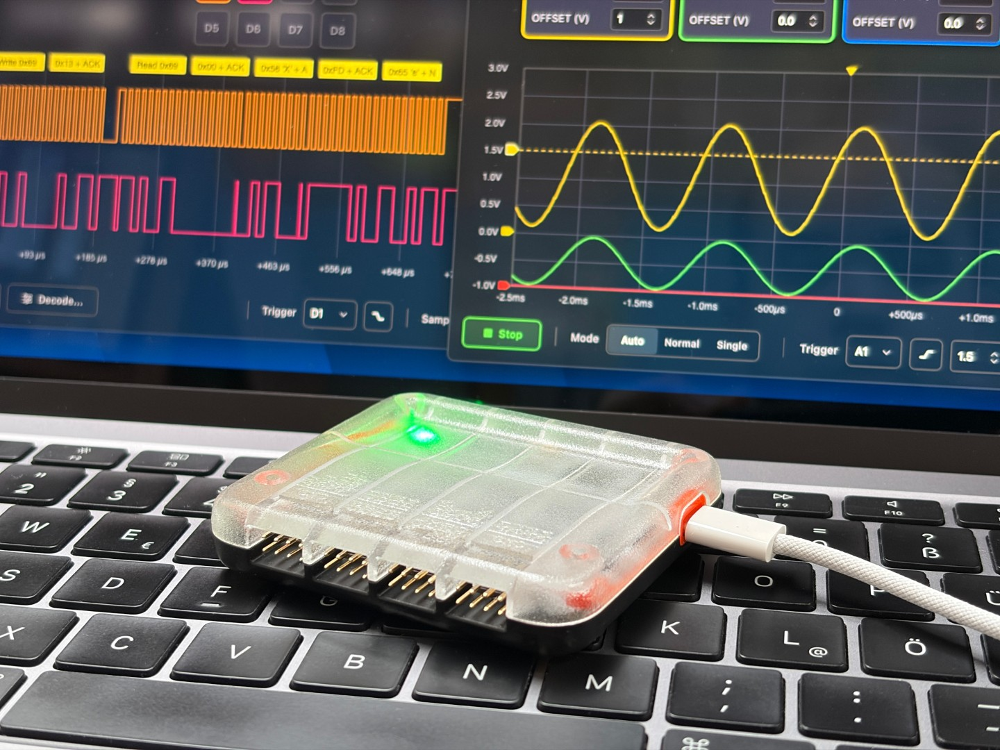
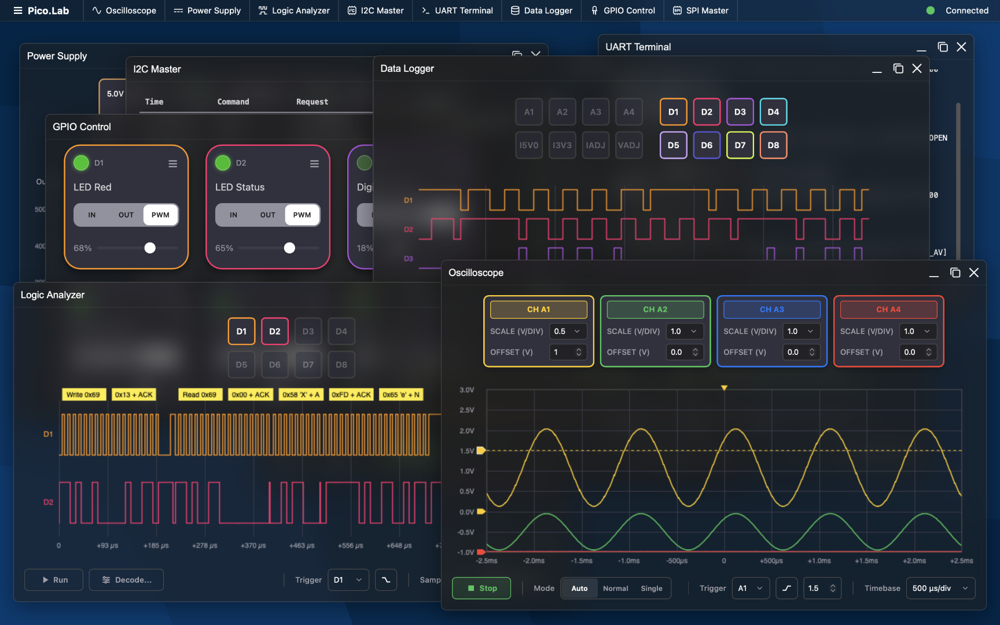
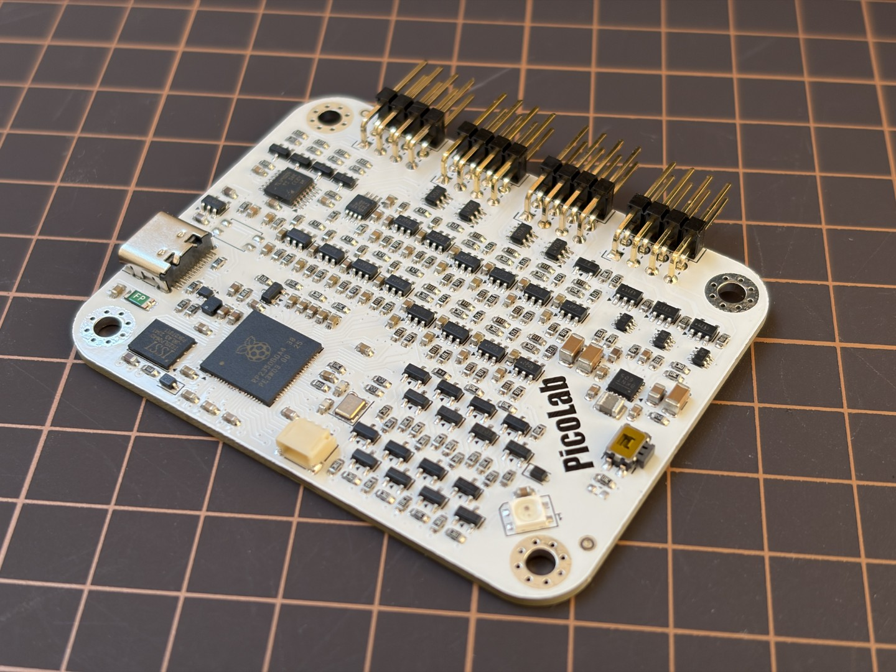

# Pico.Lab - Web-GUI Embedded Multitool




## Overview

Pico.Lab is an open-source embedded bring-up tool built around the Raspberry Pi RP2350 microcontroller. It offers an easy-to-use, window-based web user interface directly served from on-device flash over a virtual USB Ethernet link. No host software or drivers are required - just plug it in and open your browser. The interface provides a 4-channel scope, an 8-channel logic analyzer, and an adjustable power supply with real-time monitoring. It also integrates GPIO control, a data logger, and bus masters for UART, SPI, and I2C communication.

## Features

*   **Easy to use**: A fast and intuitive window-based user interface lets you control all the integrated tools easily. It supports multitasking across its tools, windows-resizing and customization. For automation you can use the integrated CLI via the virtual COM port.
*   **No extra software or hardware needed**: The entire graphical interface is hosted on device using a lightweight web server. No WebUSB needed - It works seamlessly in any browser on any modern operating system. At only 200 KB in size, the interface fits comfortably in the Pico's RAM and loads in a fraction of a second.
*   **Integrated tools**: The firmware enables the Raspberry Pi Pico to become a multi-functional instrument for analog and digital debugging. The following tools are implemented so far:
    *   **Oscilloscope**: 4-channel analog capture with configurable timebase, voltage scaling, trigger settings, and continuous/single-shot modes. Utilizes overclocked ADC (192MHz) and DMA for high-speed continuous streaming for a bandwidth of around 400 kHz.
    *   **GPIO Control**: Directly read, write, and configure the 8 GPIO pins. Supports input/output modes, Pull-up configuration, and PWM control.
    *   **Data Logger**: Long-term, slow-rate sampling of both analog and digital pins with direct `.csv` export functionality.
    *   **Logic Analyzer**: 8-channel digital capture (D0–D7) capable of capturing at up to 100 MS/s. Features adjustable timebases, edge triggering, and Run-Length Encoding (RLE) compression for high-speed transmission. Integrated decoders for UART, I2C and SPI.
    *   **UART Terminal**: Serial bridge for interacting with target devices. Includes baud rate configuration, CR/LF ending controls, and live TX/RX logging.
    *   **Power Supply Controller**: Real-time control and monitoring of adjustable voltage/current rails (5V, 3.3V, and a fully adjustable output). Live telemetry graphing for current draw and voltage levels. Only available when using the Pico.Lab board.
    *   **I2C & SPI Masters**: Dedicated bus tools to scan for I2C devices, configure bus baud rates, and execute raw read/write transactions.

## Software

Pico.Lab is built entirely on native, lightweight frameworks to maximize the RP2350's performance.



*   **Firmware Backend (C)**:
    *   Built on the **Raspberry Pi Pico SDK**.
    *   **TinyUSB**: Provides USB CDC (Serial CLI) and RNDIS/ECM (Virtual Ethernet).
    *   **lwIP**: Handles TCP/IP, DHCP (assigning an IP to your PC), DNS (resolving `pico.lab`), and the embedded HTTP server.
    *   **Dual-Core Processing**: Core 0 handles networking, USB, and UI serving. Core 1 is dedicated entirely to high-frequency ADC/DMA sampling and logic capturing.
*   **Web Frontend (HTML/JS/CSS)**:
    *   Zero-dependency Vanilla JavaScript UI. Runs fully offline.
    *   **WinBox.js**: Used for the robust, draggable, desktop-like window manager.
    *   **Server-Sent Events (SSE)**: Pushes high-speed live telemetry data from the Pico to the browser over TCP.

## Hardware

Pico.Lab is designed to run best on the custom Pico.Lab board, but is fully compatible with standard Raspberry Pi Pico (RP2040) and Raspberry Pi Pico 2 (RP2350) boards out of the box. So if you have a Pico lying around, give the .uf2 files a try!



The Pico.Lab board adds the following features:
* Support for logic voltages from 1.65V to 5.5V
* Adjustable power rail (1-5V)
* 4x Analog Channels with 12V input range and op-amp buffer
* 8x Digital Inputs/Outputs with configurable pull-ups
* Current measurement for 5V, 3.3V, and adjustable rail
* Dedicated SPI, I2C and UART pins
* Protection against ESD, over-voltage, over-current, reverse current

## Current State of this Project

My main goal for this project was to be an easy-to-use toolkit for simple debugging applications. You want to know why an I2C sensor does not respond, what current your Wifi module is drawing or why a servo does not move? Just plug your hardware in and start debugging without checking a manual first. But since this is running on a 1$ microcontroller over a USB 1.1 link, don't expect the performance of professional instruments. The Pico will do significantly worse than any dedicated scope or logic analyzer. However, with the existing hardware there is still room for improvements, for example:
* [ ] Save/Restore tool configurations
* [ ] JTAG support
* [ ] a servo tester app

## Getting Started

### Flashing the firmware
1. Download the corresponding .uf2 file for your Rp2040 or RP2350. 
2. Put the device into BOOTSEL-Mode and drop the .uf2-File into its volume.

### Connecting to Pico.Lab
1. Connect the Pico.Lab board to your computer via USB.
2. The board will mount as a virtual network adapter. It automatically acts as a DHCP server.
3. Open your web browser and navigate to:
   * **http://pico.lab**
   * *(Alternatively, http://192.168.7.1 if your OS doesn't support local DNS).*
### Serial CLI
If you prefer a command-line interface, Pico.Lab also acts as a standard USB Serial (CDC) device. Connect via your favorite serial terminal (e.g., PuTTY) at 115200 baud.
Type `help` to see a list of commands (e.g., `gpio`, `adc`, `power`, `i2c`, `spi`, `sys`).

## Building from Source

### Prerequisites
* [Raspberry Pi Pico SDK](https://github.com/raspberrypi/pico-sdk)
* CMake & Ninja/Make
* GCC ARM Embedded Toolchain

### Build Instructions
```bash
git clone https://github.com/CoretechR/picolab.git
cd picolab
mkdir build && cd build
cmake ..
make -j$(nproc)
```
Select your type of Raspberry Pi Pico board in the Pico SDK. For the Pico.Lab board, set the PICOLAB_HW_CUSTOM_BOARD define in board_config.h. You can also use this file to modify the pins for GPIO, SPI, I2C and UART.

Flash the resulting `.uf2` file to your board by holding the `BOOTSEL` button while plugging it in, then drag-and-drop the file to the `RPI-RP2` drive.

## Disclosure about AI Usage

While I remain pessimistic about the impact of AI on humanity, there is no putting it back in the box. For this project, I tried to embrace it and used it heavily to generate the firmware, web frontend and parts of the documentation. I wanted to see what I could achieve in the same amount of time that I normally put into my hobby projects. All art, design and architecture were conceived by me. 

## License

This project is licensed under the **GPL-3.0 License** - see the [LICENSE](LICENSE) file for details.
Copyright © 2026 Maximilian Kern.